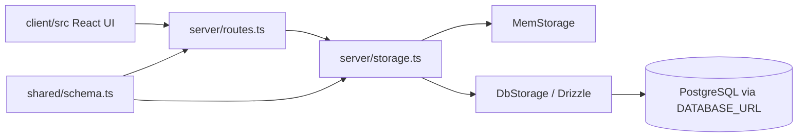

# Prompt to Product

Prompt to Product is a full-stack renewable-energy planning workspace. The React/Vite client presents regional capacity, project, financing, and carbon-emissions views; an Express/TypeScript server exposes the API and selects database-backed or in-memory storage.

## Architecture



`server/index.ts` starts Express, installs Vite middleware in development, and serves the built client in production. `server/routes.ts` validates request bodies with the shared schema and delegates persistence to the storage interface. `server/seed.ts` contains seed data and `render.yaml` describes the Render deployment.

## Features and API surface

- Project records: `GET/POST /api/projects`, `GET/DELETE /api/projects/:id`
- Carbon records: `GET/POST /api/carbon-emissions`, `GET/DELETE /api/carbon-emissions/:id`
- Financing schemes: `GET/POST /api/financing-schemes`, `GET/DELETE /api/financing-schemes/:id`
- Regional capacity: `GET/POST /api/regional-capacity`, `GET /api/regional-capacity/:state`, `DELETE /api/regional-capacity/:id`
- Interactive map, analytics cards, project management, financing information, and carbon calculations in `client/src/`

Treat these routes as the current implementation contract; they are not a versioned public API.

## Local setup

Requirements: Node.js, npm, and a PostgreSQL-compatible `DATABASE_URL` when using persistent storage.

```bash
npm ci
npm run dev
# type-check and create a production bundle
npm run check
npm run build
npm start
```

`npm run db:push` applies the Drizzle schema to the configured database. Review schema changes before running it against shared environments. Without `DATABASE_URL`, the server can fall back to its in-memory implementation, so local data may not persist.

## Project layout

| Path | Responsibility |
| --- | --- |
| `client/src/` | React pages, components, charts, map, and styling |
| `server/index.ts` | HTTP server and development/production startup |
| `server/routes.ts` | API routes and validation |
| `server/storage.ts` | Storage interface and in-memory implementation |
| `server/db-storage.ts` | Drizzle-backed persistence |
| `shared/schema.ts` | Shared database and validation schema |
| `drizzle.config.ts` | Drizzle Kit configuration |
| `render.yaml` | Deployment definition |

## Deployment and operations

The checked-in Render definition builds the Vite client and bundled server, then starts the production process. Configure `DATABASE_URL` and session/application settings through the platform secret manager. Use HTTPS, database backups, access controls, and migration review in production.

## Testing and limitations

`npm run check` is the available automated validation command; the package does not declare a unit or integration test suite. Add coverage for route validation, not-found/error responses, persistence failures, seed idempotency, and the main client workflow before production use. The prototype does not document authentication, authorization, rate limiting, or observability, and should not be used for sensitive workloads without those controls.

## Security

Do not commit database URLs, session secrets, API keys, or OAuth credentials. Validate and constrain all future uploads and user input at the server boundary, restrict database permissions, and rotate any credential exposed in repository history.

## License

See the repository license file and package metadata for the authoritative terms.
