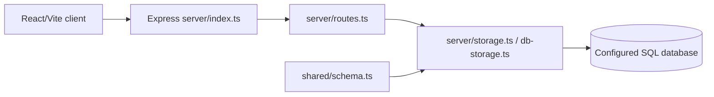

# Prompt to Product

A full-stack Vite/React and Express application for turning product concepts into a persistent workspace. It uses shared TypeScript schemas, Drizzle-compatible database access, server-side routes, and a production bundle that serves the built client.

## Architecture



Development uses Vite middleware; production serves the generated client from `dist/`. `server/seed.ts` provides initial data and `drizzle.config.ts` defines database tooling.

## Setup

```bash
npm ci
npm run dev
# validation and production
npm run check
npm run build
npm start
# apply schema changes only after review
npm run db:push
```

Set `DATABASE_URL` and any application/session variables in a local environment. Do not commit credentials.

## Request and data flow

The React client submits JSON to `/api/*`; Express validates and dispatches through `registerRoutes`, storage persists records, and the server returns JSON. `shared/schema.ts` is the canonical contract for domain fields and validation.

## Deployment

`render.yaml` provisions a Node service and PostgreSQL database, builds the client/server bundle, pushes the schema, and starts the app. For production, pin migration procedures, use a managed secret store, HTTPS, and backups.

## Testing and limitations

TypeScript checking is available through `npm run check`; no dedicated unit/integration suite is declared. Test API validation, authorization, database failure/retry behavior, seed idempotency, and the complete client workflow.

## Security and operations

- Keep credentials, database URLs, OAuth tokens, API keys, and signing secrets in environment variables; never commit them.
- Validate and constrain uploaded files and user input at the server boundary, and enable HTTPS in production.
- Review dependency updates and rotate any credential that has appeared in repository history.

## Testing

The repository currently has no comprehensive automated test suite unless noted above. Before production changes, add tests for authentication/authorization, validation failures, persistence errors, and the primary user workflow.

## Limitations and roadmap

This is an actively evolving project. Production hardening, observability, rate limiting, backup/retention policy, and accessibility/performance validation should be completed before handling sensitive or high-volume workloads.

## License

See the repository license file and package metadata for the authoritative terms.
